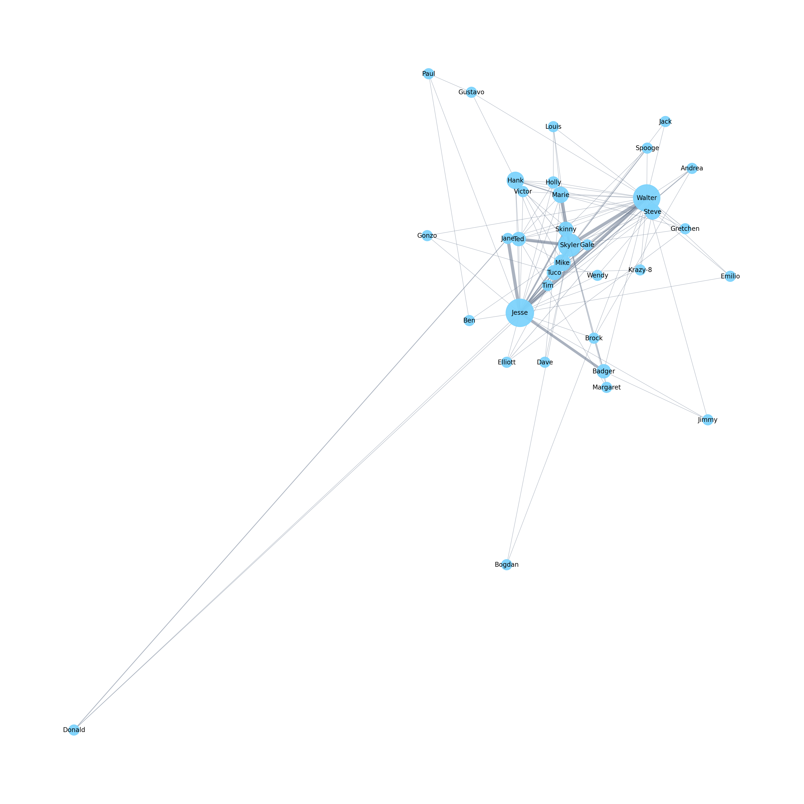

# Network of Breaking Bad

This project analyzes relationships between Breaking Bad characters using web scraping, NLP, and graph analysis. It was adapted from `the_witcher_network-main` for a Breaking Bad dataset/workflow.

## References

- Breaking Bad repo: [JiveFish2/Network-of-Breaking-Bad](https://github.com/JiveFish2/Network-of-Breaking-Bad)
- Original Witcher repo: [thu-vu92/the_witcher_network](https://github.com/thu-vu92/the_witcher_network)

## Repository Structure

- `character_scraping.ipynb`: Scrapes/organizes Breaking Bad character data.
- `extracting_relationships.ipynb`: Extracts named entities and builds character networks.
- `characters_bd.csv`: Character list used by the NLP pipeline.
- `data/`: Raw text/script inputs (`.txt`) used for relationship extraction.
- `lib/utils/functions.py`: Reusable NLP/network helper functions.

## Status

Implemented:
- Character scraping notebook for Breaking Bad character source pages.
- Relationship extraction notebook using spaCy + NetworkX.
- Utility functions for NER processing and relationship graph edge creation.

Planned:
- Improve entity normalization (aliases, duplicate names, nicknames).
- Expand and clean episode/script coverage in `data/`.
- Improve visualization outputs and centrality/community analysis reporting.

## Requirements

- Python 3.10+
- Chrome installed (for Selenium runs in the scraping notebook)

Install dependencies:

```bash
python3 -m venv .venv
source .venv/bin/activate
pip install -r requirements.txt
python -m spacy download en_core_web_sm
```

## Running

1. Start Jupyter:
```bash
jupyter notebook
```
2. Run `character_scraping.ipynb` to generate/update character data.
3. Run `extracting_relationships.ipynb` to build and visualize relationship graphs.

## Character Graph



## Notes

- Relationship extraction expects `.txt` files in `data/`.
- Utility functions are imported from `lib/utils/functions.py`.

## Expected Input Formats

- `characters_bd.csv`:
  - Required column: `character`
  - Optional/used in notebook: `season`
  - The relationship notebook derives `character_firstname` internally.
- `data/*.txt`:
  - Plain UTF-8 text files.
  - Typically one file per episode/script chunk.
  - Dialogue/scenes in readable transcript form (speaker names in text are helpful for NER quality).

## Known Limitations

- NER is based on `en_core_web_sm`, which can miss entities or merge/split names incorrectly.
- Character matching currently relies on exact name/first-name heuristics.
- Relationship strength is proximity-based (windowed co-occurrence), not semantic interaction detection.
- Results depend heavily on transcript quality and consistency.
